  

  
  
  
  

I'm a CS student at Columbia who likes building the layer underneath: LLM serving and KV-cache management, replicated storage and consensus, and the occasional Android feature that has to survive an A/B test.

**Right now**
- **COMET:** KV-cache eviction and recovery for long-horizon LLM agents, extending Mini-SGLang to serve Qwen3 on A100s (graduate Scaling LLM Systems seminar)
- **NASA SUITS:** leading the UI and computer vision team building AR displays for Artemis moonwalks
- Looking for **Summer 2027 SWE internships** on any team. I'm especially drawn to infrastructure, ML systems and inference, but I love building across the stack. Available May 14 to Sep 7 and happy to relocate

### Experience

| | |
|---|---|
| **ByteDance** · Douyin Social & Messaging | Built an in-feed messaging bar for the Android app, live after its A/B test |
| **Trizen AI** · Medical speech recognition | Trained a clinical ASR model: data pipeline, SFT plus continued pretraining, medical-weighted eval |
| **EleutherAI** · SoAR Research Fellow | Probed whether LLMs represent the chemistry behind drug-toxicity answers |
| **Columbia CRIS Lab** · AI Research Engineer | SAE features and causal interventions on Gemma-3-27B |
| **Helios Healthcare** · Software Engineer | Flask and PostgreSQL APIs over 15,000+ nursing homes, 30% faster search |

### Selected work

| Project | What it is |
|---|---|
| [**EdgeLab**](https://github.com/HenryWashuHe/edgelab) | Cloudflare Workers reliability lab: SQLite-backed Durable Objects, leased scheduling with revision fencing, SLOs and error budgets, plus a real quota-failure repair |
| [**math_llm_reasoning**](https://github.com/HenryWashuHe/math_llm_reasoning) | Does RAG switch on reasoning subroutines? SAE features and causal interventions on Gemma-3-27B |
| [**genesis**](https://github.com/HenryWashuHe/genesis) | Infrastructure for agents that build, verify and repair shared tool libraries with fixed model weights |
| [**SCDS**](https://github.com/HenryWashuHe/washuhackathon2025) | Multi-agent climate adaptation planner with typed claims between agents |
| [**AI Sports Coach**](https://github.com/HenryWashuHe/Best-AI-For-Gym) | Form feedback from photos and video with Gemini on Vertex AI |
| [**TrackATeam**](https://github.com/HenryWashuHe/Morgan-Stanley---Code-to-Give-Hackathon) | Volunteer platform with LangGraph agents on AWS Bedrock |
| [**SUITS AR**](https://github.com/columbiaspace/SUITS-MagicLeap-26) | AR assistant for moonwalks on Magic Leap 2 with DINOv3 damage detection |

### Wins

🏆 **Winner**, WashU Skandalaris AI Hackathon (SCDS)  
🏆 **Winner**, Google DevFest 25: Build with AI (AI Sports Coach)  
🥈 **2nd place**, Morgan Stanley Code to Give (TrackATeam)  
🚀 **Presented at NASA Johnson Space Center**, SUITS 2026

### Toolbox

  

Plus CUDA, SGLang, vLLM, LangGraph, Hugging Face Transformers, SAE-Lens, Slurm and Vertex AI.

<b>Off the clock</b>

 

Played baseball as a student athlete with MLB China. Big on snooker, the gym, food and travel. I read a lot of fiction (Woolf, Morrison and Homer are favorites) and take cosmology classes for fun.

